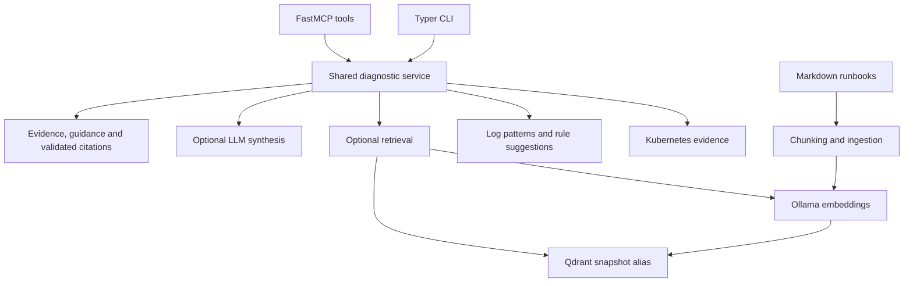

# kube-assistant-mcp

**Agentic Kubernetes troubleshooting — as a CLI and as an MCP server.**

`kube-assistant-mcp` connects a local LLM (via [Ollama](https://ollama.com)) or a hosted one (OpenAI-compatible) to your Kubernetes cluster. It scans for failing Pods (`CrashLoopBackOff`, `OOMKilled`, `ImagePullBackOff`, ...), correlates logs + events, and explains the root cause in plain language — or generates ready-to-use Deployment/Helm manifests.

It's built for **tier 1/2 support engineers** who get limited, read-only cluster access and aren't trained or authorized to change Kubernetes resources themselves. This tool never mutates the cluster it's pointed at — instead, once it has a diagnosis, it can open a **Jira bug ticket** with the root cause and a recommended fix, so an engineer with write access can act on it. That turns "I don't know k8s well enough to fix this safely" into a five-minute, well-documented handoff instead of a blocked ticket queue.

It ships two ways to use it:

- **CLI** — `kube-assistant scan / diagnose / open-ticket / generate`
- **MCP server** — the same capabilities exposed as tools for **Cursor** or **Claude Desktop**, so an AI agent can diagnose your cluster and file the ticket in natural language.


*A plain-English request → the agent scans and diagnoses a real failing pod → files a Jira ticket with the root cause and exact fix → the real ticket in Jira.*

```
$ kube-assistant scan -n production
┏━━━━━━━━━━━━┳━━━━━━━━━━━━━━┳━━━━━━━━━━━━━━━━━━┳━━━━━━━━━━┳━━━━━━━━━━┓
┃ Namespace  ┃ Pod          ┃ Issue            ┃ Restarts ┃ Severity ┃
┡━━━━━━━━━━━━╇━━━━━━━━━━━━━━╇━━━━━━━━━━━━━━━━━━╇━━━━━━━━━━╇━━━━━━━━━━┩
│ production │ api-7f8c9d   │ CrashLoopBackOff │ 14       │ critical │
│ production │ worker-2     │ OOMKilled        │ 3        │ high     │
└────────────┴──────────────┴──────────────────┴──────────┴──────────┘
```

## Why

Debugging a failing Pod is a repetitive, mechanical loop: `describe` → `logs --previous` → `get events` → guess → fix. This tool automates the mechanical part and hands the LLM only the *relevant, structured* context it needs to actually help — instead of dumping a whole terminal session into a chat window.

## Features

- **Detection** — classifies container states (`waiting`/`terminated` reasons) into known failure types with a severity score.
- **Log analysis** — regex-based pattern matching for common root causes (OOM, connection refused, DNS failure, missing env vars, permission errors, bad config, port conflicts, unhandled exceptions) — works even with the LLM turned off.
- **LLM diagnosis** — sends a compact, structured JSON payload (issue + log tail + recent events) to Ollama or an OpenAI-compatible endpoint and gets back a plain-language explanation plus a list of concrete fixes.
- **Jira ticket creation** — once a pod is diagnosed, open a Jira bug ticket with the root cause and a recommended fix in one call — the cluster itself is never touched.
- **Manifest generation** — emits a Deployment+Service YAML pair, or a minimal, valid Helm chart skeleton.
- **MCP server** — built with [FastMCP](https://github.com/jlowin/fastmcp); drop it into Cursor or Claude Desktop and diagnose your cluster conversationally.

## Optional operational knowledge retrieval (Week 1)

The source checkout now supports local Markdown RAG through Ollama embeddings and Qdrant. Seven runbooks and two clearly labeled synthetic postmortems cover common Kubernetes incidents. Retrieved guidance includes source paths, headings, content hashes and chunk IDs; it remains separate from observed cluster evidence.

```bash
pip install -e '.[dev,rag]'
docker compose -f compose.rag.yml up -d
ollama pull embeddinggemma
kube-assistant knowledge ingest knowledge
kube-assistant knowledge search 'OOMKilled memory limit'
kube-assistant diagnose <pod> -n <namespace> --rag --no-llm
```

RAG is disabled by default. Retrieval and chat failures preserve rule-based diagnostics. The existing five MCP tools remain; `diagnose_pod` accepts `use_rag`. No commands suggested by the model are executed. These source changes have not been published to PyPI.

The seven-query local retrieval pilot found the expected runbook in the top three for all seven queries. This is not a diagnostic-accuracy benchmark. Valid citations do not prove that a model's conclusions are supported.

## Installation

### Option A — from PyPI

```bash
pip install kube-assistant-mcp
kube-assistant setup       # installs missing prerequisites (kubectl, Helm, Ollama + model) via Homebrew/official scripts
kube-assistant doctor      # verifies everything is ready
```

### Option B — from source (one command)

```bash
git clone https://github.com/yonatani94/kube-assistant-mcp
cd kube-assistant-mcp
make setup                  # creates a venv, installs the Python package, runs the doctor check
source .venv/bin/activate
kube-assistant setup        # installs missing system tools (kubectl/Helm/Ollama) — different from `make setup` above
```

`make setup` bootstraps the *Python* side (venv + package). `kube-assistant setup`
installs the *system* prerequisites the package needs to actually talk to a
cluster and an LLM. Either way, `kube-assistant doctor` is the always-safe,
read-only check: it verifies Python 3.10+, `kubectl` + cluster connectivity,
and your configured LLM backend (Ollama or OpenAI), and tells you exactly
what's missing. `kube-assistant setup` is the read-write counterpart — it
offers to actually install what's missing (with a dry-run mode and a
confirmation prompt before anything runs).

Requires Python 3.10+ and a working `kubeconfig` (the same one `kubectl` uses).
For LLM-powered diagnosis, run [Ollama](https://ollama.com) locally
(`ollama pull llama3.1`, the default — no API key needed), or point at a
hosted provider instead: OpenAI, Anthropic (Claude), Google Gemini, or Groq —
see [Configuration](#configuration) below.

New to any of this? See **[PREREQUISITES.md](PREREQUISITES.md)** for full install
instructions (Python, kubectl, Ollama) and a hardware/model-size guide.

## CLI usage

```bash
# List every failing pod in the cluster (or one namespace)
kube-assistant scan -n production

# Deep-dive: logs + events + LLM root-cause explanation + fix suggestions
kube-assistant diagnose api-7f8c9d -n production

# Same, but skip the LLM call and only use the rule-based fixes
kube-assistant diagnose api-7f8c9d -n production --no-llm

# Diagnose, then open a Jira bug ticket with the root cause + recommended
# fix (asks for interactive confirmation unless -y). Requires Jira config —
# see "Jira configuration" below.
kube-assistant open-ticket api-7f8c9d -n production

# Generate a plain manifest or a Helm chart
kube-assistant generate myapp --image myrepo/myapp:1.4.0 --kind manifest
kube-assistant generate myapp --image myrepo/myapp:1.4.0 --kind helm
```

## Using it as an MCP server (Cursor / Claude Desktop)

Start it directly:

```bash
kube-assistant serve
```

Or point your MCP client config at it. Example for Claude Desktop
(`claude_desktop_config.json`):

```json
{
  "mcpServers": {
    "kube-assistant": {
      "command": "kube-assistant",
      "args": ["serve"]
    }
  }
}
```

Exposed tools: `list_failing_pods`, `get_pod_logs`, `diagnose_pod`, `open_jira_ticket`, `generate_manifest`. None of these mutate the cluster — the server is read-only.

## Configuration

kube-assistant supports five LLM backends. Set `KUBE_ASSISTANT_LLM_BACKEND`
to pick one — everything else (model default, which API key to read) follows
automatically:

| Backend | `KUBE_ASSISTANT_LLM_BACKEND` | API key env var | Default model |
|---|---|---|---|
| Ollama (local, default) | `ollama` | *none needed* | `llama3.1` |
| OpenAI | `openai` | `OPENAI_API_KEY` | `gpt-4o-mini` |
| Anthropic (Claude) | `anthropic` | `ANTHROPIC_API_KEY` | `claude-sonnet-4-5` |
| Google Gemini | `gemini` | `GEMINI_API_KEY` | `gemini-2.0-flash` |
| Groq | `groq` | `GROQ_API_KEY` | `llama-3.3-70b-versatile` |

```bash
# Example: use Claude instead of a local model
export KUBE_ASSISTANT_LLM_BACKEND=anthropic
export ANTHROPIC_API_KEY=sk-ant-...
kube-assistant diagnose <pod> -n <namespace>

# Or per-command, without changing your shell's defaults:
kube-assistant diagnose <pod> --llm-backend gemini --llm-model gemini-2.0-flash
```

Other env vars:

| Env var | Default | Purpose |
|---|---|---|
| `KUBE_ASSISTANT_LLM_MODEL` | *(per-backend, see table above)* | Overrides the default model for whichever backend is active |
| `KUBE_ASSISTANT_LLM_BASE_URL` | `http://localhost:11434` | Ollama endpoint only |
| `KUBE_ASSISTANT_LLM_API_KEY` | — | Generic override — takes priority over the backend-specific key env var above |
| `KUBE_ASSISTANT_LLM_TIMEOUT` | `60` | Request timeout in seconds |

Model names and aliases change over time — the defaults above are reasonable
starting points, not guarantees; override with `KUBE_ASSISTANT_LLM_MODEL` if
your provider has moved on. `kube-assistant doctor` checks that the right
API key is set for whichever backend you've configured.

Adding a sixth provider is one small class in `llm_client.py`: subclass
`LLMBackend` (or `OpenAICompatibleBackend` if it speaks the OpenAI chat
shape) and register it in `_BACKEND_CLASSES`.

### Jira configuration

`open_jira_ticket` (MCP tool) and `kube-assistant open-ticket` (CLI) file a
ticket in **Jira Cloud**. Set these env vars:

| Env var | Required | Purpose |
|---|---|---|
| `JIRA_URL` | yes | Your Jira Cloud site, e.g. `https://yourcompany.atlassian.net` |
| `JIRA_EMAIL` | yes | Account email tied to the API token |
| `JIRA_API_TOKEN` | yes | API token — create one at [id.atlassian.com/manage-profile/security/api-tokens](https://id.atlassian.com/manage-profile/security/api-tokens) |
| `JIRA_PROJECT_KEY` | yes | Default project to file tickets in, e.g. `OPS` (the CLI's `--project` flag overrides this per call) |
| `JIRA_ISSUE_TYPE` | no (default `Bug`) | Issue type name, must exist in the target project |
| `JIRA_TIMEOUT` | no (default `30`) | Request timeout in seconds |

```bash
export JIRA_URL=https://yourcompany.atlassian.net
export JIRA_EMAIL=you@yourcompany.com
export JIRA_API_TOKEN=ATATT3x...
export JIRA_PROJECT_KEY=OPS
kube-assistant open-ticket api-7f8c9d -n production
```

## Architecture



Qdrant provides the standalone knowledge index. The project has no existing PostgreSQL investment, so a local Qdrant container adds a small operational footprint. Retrieval uses a separately configured embedding model. Shared diagnostic logic serves both CLI and MCP.

## Development

```bash
git clone https://github.com/yonatani94/kube-assistant-mcp
cd kube-assistant-mcp
make setup
pytest
```

The default test suite uses mocked Kubernetes/LLM responses and Qdrant local mode; it requires no cluster or network. The opt-in live RAG test requires local Qdrant and Ollama. Install the dev and rag extras to exercise all offline retrieval tests.

## Safety notes

This tool is **read-only against the cluster** — it never deletes, patches,
or otherwise mutates anything it's pointed at. It only ever calls `list`,
`get`, `logs`, and `events` against the Kubernetes API, and its separate integrations can write local generated files, index knowledge in Qdrant, or open a Jira
ticket (an explicit, separate call — `open_jira_ticket` / `open-ticket`).

This is intentional: the tool is designed for support tiers who have
limited, read-only cluster access by policy, not as an implementation
detail. A minimal RBAC `ClusterRole` covering everything this tool needs:

```yaml
apiVersion: rbac.authorization.k8s.io/v1
kind: ClusterRole
metadata:
  name: kube-assistant-readonly
rules:
  - apiGroups: [""]
    resources: ["pods", "pods/log", "events", "namespaces"]
    verbs: ["get", "list", "watch"]
```

Bind that (not `edit`/`admin`) to the ServiceAccount or user running
`kube-assistant`/the MCP server, and Kubernetes authorization provides an independent write boundary. The legacy
`apply_yaml` helper now raises PermissionError; no investigation path executes remediation.

## Local RAG setup and operation

## Start from the source checkout

```bash
python3 -m venv .venv
source .venv/bin/activate
pip install -e '.[dev,rag]'
docker compose -f compose.rag.yml up -d
# Start Ollama separately if it is not already running: ollama serve
ollama pull embeddinggemma
kube-assistant knowledge ingest knowledge
kube-assistant knowledge search 'Pod cannot start: image manifest unknown'
```

The Compose service binds Qdrant only to 127.0.0.1:6333 and persists vectors in a named volume. Ollama runs on the Mac host; the Python application also runs on the host. This preserves local inference without requiring a full application container. The optional extra pins qdrant-client 1.14.3, verified with Qdrant server 1.14.1. These are tested versions, not a claim that they are latest. No cloud services or Kubernetes cluster are needed for ingestion/search.

If port 6333 is occupied, set `QDRANT_PORT=6335` for Compose and `KUBE_ASSISTANT_QDRANT_URL=http://localhost:6335` for Python. Do not expose this unauthenticated development database outside localhost. Start a single ingestion writer per collection alias.

### Diagnosis

```bash
# Existing behavior: RAG is disabled by default.
kube-assistant diagnose <pod> -n <namespace> --no-llm --no-rag
# Add retrieved guidance without requiring a chat model.
kube-assistant diagnose <pod> -n <namespace> --rag --no-llm
# Both optional AI components.
kube-assistant diagnose <pod> -n <namespace> --rag
```

Existing five MCP tools remain. `diagnose_pod` accepts optional `use_rag`; omitted means use the environment setting, false explicitly disables retrieval. Existing output keys remain, with added `evidence`, `retrieved_guidance`, `citation_ids`, `rag_status` and `llm_status`. `--rag` also works with the explicit CLI `open-ticket` operation; no test or demo sends a Jira ticket. MCP direct log output receives best-effort redaction and tail_lines is bounded to 1–2000.

### Cluster-free demonstration and checks

```bash
python scripts/demo_week1.py                    # deterministic rules, no services
python scripts/demo_week1.py --rag              # real retrieval, synthetic evidence
KUBE_ASSISTANT_LLM_MODEL=qwen2.5:1.5b python scripts/demo_week1.py --rag --llm
python scripts/evaluate_week1.py > /tmp/week1-results.json
pytest -q                                     # offline suite; live test skipped
RUN_LIVE_RAG=1 pytest tests/integration -q       # actual Ollama + Qdrant
```

The chat demo requires the selected model to have been pulled separately. `qwen2.5:1.5b` was already installed on the audit machine; no chat model default was changed. The integration test uses a unique test collection and removes only its own snapshots. The evaluation script ingests into the configured collection alias and is intended for the example corpus. Never point it at an unrelated knowledge index.

The demo clearly labels its evidence synthetic. A successful model response means schema/citation validation passed, not that its interpretation is proven. The live smoke response inferred memory growth without a measured memory trend: this remains an unsupported inference to catch in later faithfulness evaluations.

### Configuration

| Variable | Default | Purpose |
|---|---|---|
| KUBE_ASSISTANT_RAG_ENABLED | false | Enable retrieval for diagnosis; CLI/MCP explicit options override |
| KUBE_ASSISTANT_QDRANT_URL | http://localhost:6333 | Vector database URL |
| KUBE_ASSISTANT_RAG_COLLECTION | kube_assistant_knowledge | Active snapshot alias; dedicated to one corpus |
| KUBE_ASSISTANT_EMBED_MODEL | embeddinggemma | Embedding model, independent of chat provider |
| KUBE_ASSISTANT_EMBED_URL | http://localhost:11434 | Ollama embedding server |
| KUBE_ASSISTANT_RAG_TIMEOUT | 30 | Per-request timeout, 1–120 seconds |
| KUBE_ASSISTANT_RAG_TOP_K | 3 | Maximum passages, 1–10 |
| KUBE_ASSISTANT_RAG_CONTEXT_CHARS | 5000 | Retrieval context character budget, 200–20000 |
| KUBE_ASSISTANT_RAG_CHUNK_CHARS | 1600 | Maximum chunk characters, 200–16000 |
| KUBE_ASSISTANT_RAG_OVERLAP | 160 | Prose overlap, less than half the chunk size |

Timeout is per request, not a global investigation deadline; Week 2 adds workflow budgets. Character limits are not exact token limits. Oversized fenced code blocks and unclosed fences fail ingestion rather than silently truncating commands. Overlap applies within a section, not across unrelated headings. Empty ingestion is rejected to avoid accidentally replacing an index with nothing.

### Index lifecycle and attribution

Every chunk carries a UUID derived from relative source path, content hash, chunking configuration and index; it also stores document ID, source, heading and review date. Query/document vectors use the same model. The Ollama model digest and vector dimension are checked against index metadata. A changed model requires a new collection alias and complete reindex.

Repeat ingestion of identical documents is a no-op. Changed or removed documents produce a new complete snapshot, then Qdrant switches the alias. Old snapshots are retained so active readers and operators can use them for rollback. Failed writes can leave orphan snapshots; inspect and clean old collections explicitly after confirming no active readers need them. Concurrent writers, automatic retention and cross-tenant isolation are outside this increment.

Sources come from stored metadata, not model-authored references. Model citation IDs must belong to the passages actually supplied. Model-authored Markdown links, URLs and Markdown file references in explanatory prose are rejected. This enforces reference integrity but cannot prove that every sentence follows from a passage. Citation IDs do not constitute confidence scores.

### Failure modes and limits

- Retrieval unavailable, missing optional dependency, model mismatch or invalid config: diagnosis keeps rules and reports `rag_status=unavailable`.
- Chat unavailable, invalid credentials, malformed JSON/schema or unknown citations: diagnosis keeps rules and reports `llm_status=unavailable`.
- Retrieval works without chat. No generated command is executed.
- Redaction covers common credential assignments, bearer tokens, JWT-like values, private keys and URL credentials. It is best effort, not a complete secret scanner. Treat documents/logs as untrusted and avoid sending sensitive data to hosted models.
- Source Markdown is stored in Qdrant; use a curated nonsensitive corpus. Reindex after document edits and review dated guidance before applying it.
- Semantic search returns nearest passages, even for unrelated questions; no calibrated relevance threshold, hybrid search or reranker is implemented yet.
- Existing classifier limitations remain: not every Pending/probe/init-container incident is discovered automatically. Runbook retrieval supports these topics independently.

Stop the local service without deleting its data:

```bash
docker compose -f compose.rag.yml stop
```

## Evaluation and roadmap

The Week 1 offline suite passed 98 tests. The real Ollama/Qdrant integration test passed separately. Ruff, package builds and dependency checks passed. Seven authored queries achieved expected-runbook Hit@3 of 1.0 and MRR@3 of 0.929. The measured corpus contains 34 chunks from nine documents. Raw results are available in [the evaluation artifact](docs/week1-retrieval-results.json). The live model inferred memory growth without a measured trend, so generated hypotheses still require evidence review.

Week 1 is complete. Week 2 adds bounded multi-step investigation and state. Week 3 adds tracing, metrics and security controls. Week 4 adds a larger incident evaluation set and delivery demonstrations.

RAG supplies versioned operational knowledge at inference time. Query and document embeddings use the same model digest. Changing the model requires rebuilding the index. Chunk provenance supports audit and source attribution, while claim support requires separate evaluation.

## License

MIT — see [LICENSE](LICENSE).
